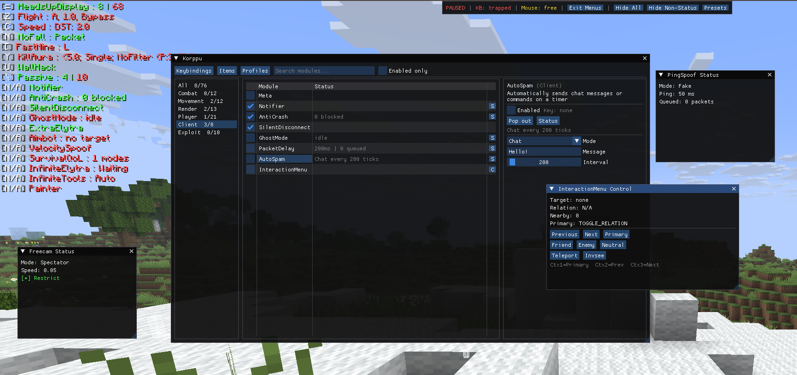

# korppu

### Minecraft cheat client mod

Fabric, currently on 26.1.2. Needs Fabric API. Java 25.

#### Download the latest build from [Releases](https://github.com/0mlml/korppu/releases)

Every push is also built by GitHub Actions; the jar is attached to each run as an artifact.

Build it yourself with `./gradlew build`, the jar ends up in `build/libs/`. `./gradlew buildAndMoveJar` also copies it to `releases/korppu.jar`.

- Insert opens the gui
- Hold right alt to get the mouse and player list without opening the full gui
- ` (grave) opens the console, commands go there. `help` lists them
- Press the keybind to toggle a module
- Press rightshift + the keybind to configure a module
- Binds can be changed from the Keybindings button in the gui or in the vanilla keybind menu
- Esc closes the gui

Gui is ImGui now. There are window layout presets, item presets, a player manager (friends/enemies) and a bunch of modules have their own status/control windows.

Not every exploit module has been retested since the port to 26.1.2, so some may be broken or patched on current servers.

Looks like this:

